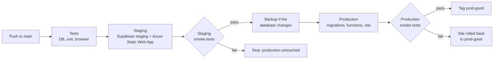

# Ryno-Tec DevOps runbook

How code reaches production, how everything is backed up, and how to recover. This covers
RTC Rentals in detail and the other Ryno-Tec projects in summary.

**Split (hybrid):** applications and sites run on **GitHub Actions**. Azure infrastructure (backup
storage, the staging site, the budget) runs on **Azure DevOps** from the `Ryno-Tec/rtc-platform` repo.



## 1. RTC Rentals pipeline (`.github/workflows/ci-deploy.yml`)

| Stage | What happens |
|---|---|
| Tests | Database migration and behaviour tests on Postgres, Ozow signing and web unit tests, browser tests in demo mode |
| Staging | Migrations to the **staging** Supabase project, Edge Functions, the site published to the Azure Static Web App with a STAGING ribbon and `noindex` |
| Staging smoke | Site and config, key pages, database API with row-level security, auth, functions deployed and refusing anonymous calls, ops-health |
| Production | Encrypted database backup **if** there are new migrations (kept 30 days as a run artifact) → migrations → functions → site |
| Production smoke | Same checks against `rentals.ryno-tec.co.za` |
| Afterwards | Pass: `prod-good` tag moves to this commit. Fail: the site goes back to `prod-good` and the run fails |

Rules built in:

- Production starts only when staging passed. Before staging is switched on, it starts straight after the tests.
- Staging refuses to run if any staging value points at the production project.
- Database changes are never rolled back automatically. Fix forward with a new migration; the pre-change backup is in the run's artifacts.
- Migrations run with `supabase db push` and are recorded in `supabase_migrations.schema_migrations`. A database that has the app's tables but no history is refused until it is baselined (step 3 below).
- **On demand:** `Actions → Smoke test` checks production or staging.

### Writing migrations from now on

Add `supabase/migrations/019_<what>.sql` (next number). Make it safe to apply to a live database: add columns as nullable or with a default, and backfill in the same file. The pipeline applies it to staging first, then production.

## 2. Backups (`.github/workflows/backup.yml`)

| What | When | Kept |
|---|---|---|
| Database: `pg_dump` (full) + Supabase roles/schema/data dumps + exact row counts | Nightly 01:23 | Azure 90 days · SharePoint 90 days · GitHub 30 days |
| Storage files (photos, signed leases), all buckets | Nightly, same package | same |
| Every GitHub repo as a git bundle (all branches and tags) | Sundays 03:23 | Azure 180 days · SharePoint 180 days · GitHub 8 weeks |

How it works:

- **Restore test.** Every night the dump is restored into a throwaway Postgres and the row counts are compared with live. A mismatch fails the run.
- **Encryption.** Everything is encrypted with [age](https://age-encryption.org) to `BACKUP_AGE_RECIPIENT` before leaving the runner. Only your private key can open it, and that key never goes to GitHub.
- **Three destinations, tried independently:**
  - **Azure Blob:** geo-redundant (South Africa North → West), no account keys, write-once for 14 days, then Cool → Cold → deleted.
  - **Private repo `Ryno-Tec/rtc-backups`:** one branch per backup; old branches are deleted.
  - **SharePoint:** `Backups/<kind>/<date>/` in the backup site. The app can reach that one site only.
- **Run summary.** Each run shows a table of the destinations. A failed destination fails the run, after the others have been tried. An unconfigured destination is a warning.
- **Monitoring.** Khaphela alerts if no backup has succeeded for 30 hours.

> **The private key is the backup.** Without it nothing can be restored. Keep `rtc-backup-key.txt`
> in your password manager **and** an offline copy (USB or printed QR) somewhere other than your laptop.

### Restore

Do this on your own machine; the private key never goes to GitHub or CI.

1. **Download the latest backup** from any destination: Azure portal → storage account → `rtc-rentals`, SharePoint `Backups/rtc-rentals`, or the newest `rtc-rentals/…` branch of `rtc-backups`. If it was split, join the parts first: `cat x.part-* > x`.
2. **Unpack and inspect:** `scripts/devops/restore.sh <file>.tar.zst.age rtc-backup-key.txt`
3. **Rehearse on staging:** `scripts/devops/restore.sh <file> rtc-backup-key.txt "$STAGING_DB_URL"`
4. **Production only after a rehearsal on staging.** The script asks you to type `RESTORE-PRODUCTION`.
5. **Storage files** are in `storage/<bucket>/`. Upload them with `aws s3 sync … --endpoint-url https://<ref>.supabase.co/storage/v1/s3`.

Do a **restore drill on staging every quarter** (Khaphela's monthly report reminds you). Write down how long it took; that is your real recovery time.

Targets: you lose at most one day of data (RPO 24 h); service is back within 4 hours (RTO 4 h, rehearsed).

## 3. One-time setup (in this order)

The pipeline already works without any of this (production deploys as before). Each step switches on more.

**A. Backup key, on your PC**

1. Install age: `winget install FiloSottile.age` or `brew install age`.
2. Run `age-keygen -o rtc-backup-key.txt`, then store the file as described above.
3. Copy the `age1…` public key into the GitHub **repository variable** `BACKUP_AGE_RECIPIENT`.

**B. Database access for the pipeline**

1. In Supabase (production) → Connect → **Session pooler**, copy the URI with the password filled in into the **repository secret** `SUPABASE_DB_URL`.
2. Baseline once, because migrations 001–018 were run by hand:
   ```bash
   SUPABASE_DB_URL='…' scripts/devops/baseline.sh 018
   ```
3. Storage backups: Supabase → Storage → S3 Connection → **New access key**. Add the repo secrets `SUPABASE_S3_KEY_ID` and `SUPABASE_S3_SECRET`, and the variable `SUPABASE_S3_REGION` (the region shown on that page).

**C. Azure platform (Azure DevOps).** In the `rtc-platform` repo:

1. Run `SUBSCRIPTION_ID=… BACKUP_SITE=rynotecconsulting.sharepoint.com:/sites/<site> scripts/setup.sh entra`
2. Create the Azure DevOps organisation at <https://dev.azure.com> (for example `ryno-tec`) and connect it to the tenant.
3. Run `SUBSCRIPTION_ID=… ADO_ORG=https://dev.azure.com/ryno-tec scripts/setup.sh ado`. It stops once to ask you to connect GitHub; run it again afterwards.
4. Request the free pipeline minutes if Azure DevOps asks for them: <https://aka.ms/azpipelines-parallelism-request>.
5. Run the `rtc-platform-infra` pipeline, then `scripts/setup.sh github`. That copies these into `rtc-rentals`:
   - variables `AZURE_CLIENT_ID`, `AZURE_TENANT_ID`, `AZURE_SUBSCRIPTION_ID`, `BACKUP_STORAGE_ACCOUNT`, `BACKUP_SP_SITE_ID`
   - in the staging environment: the variable `STAGING_SITE_URL` and the secret `STAGING_SWA_TOKEN`

**D. Staging Supabase project.** Create the free project `rtc-rentals-staging`, then in the GitHub **staging** environment add:

- variables `STAGING_SUPABASE_URL` and `STAGING_SUPABASE_ANON_KEY`
- secrets `STAGING_DB_URL` (session pooler URI) and `STAGING_KHAPHELA_KEY` (any new random value)

In that Supabase project, also do the following:

1. Add the staging site URL under Auth → URL Configuration.
2. Turn on email sign-in.
3. Leave Ozow unconfigured, or use Ozow test credentials only.

Finally set the repository variable `STAGING_ENABLED=true`. The next push deploys staging first.

**E. GitHub backup repo.**

1. On your PC run `ssh-keygen -t ed25519 -N '' -f rtc-backups-deploy -C rtc-backups`.
2. In `rtc-backups` → Settings → Deploy keys, add `rtc-backups-deploy.pub` **with write access**.
3. In `rtc-rentals`, add the secret `BACKUP_REPO_KEY` (the private file's contents) and the variable `BACKUP_REPO=Ryno-Tec/rtc-backups`, then delete both key files from your PC.

**F. Repo bundles.**

1. Create two read-only fine-grained tokens (Contents: read):
   - one for the **Ryno-Tec** org, all repos → secret `BACKUP_GITHUB_TOKEN`
   - one for your **Kagiso933** repos → secret `BACKUP_GITHUB_TOKEN_KG`
2. Set the variable `BACKUP_REPOS` to:
   `Ryno-Tec/rtc-rentals Ryno-Tec/ryno-tec-hub Ryno-Tec/Ryno-Tec-Consulting Ryno-Tec/khaphela Ryno-Tec/spaceman-dash Ryno-Tec/rtc-platform Kagiso933/etender-pro Kagiso933/csms-platform Kagiso933/Patel`

**G. Test.**

1. Run `Actions → Backups → Run workflow` (both).
2. Check the summary table.
3. Do a first restore to staging.

## 4. Other projects

| Project | Pipeline |
|---|---|
| Hub, website, eTender | `pages.yml`: link/asset/JSON checks and a JS syntax check (plus the Hub sign-in render and source drift check, and eTender data checks), then publish to GitHub Pages, then a live check. Publishing switches over when the repo variable `PAGES_VIA_ACTIONS=true` is set **and** Settings → Pages → Source is "GitHub Actions". eTender's 6-hourly data refresh publishes through the same workflow. |
| CSMS (RTC Charge) | GitHub: Bicep build/lint and a secret scan. Azure DevOps: `csms-infra` validates the Bicep. Nothing is deployed until the platform is ready to host. |
| Patel (NFC wallet) | Backend install from the lockfile, every module loads, `npm audit` (high and above), and a secret scan |
| Khaphela | Existing CI. It now also watches the nightly backup |
| SpaceMan | Already has its own full pipeline set (unchanged) |
| All repos | Dependabot weekly, grouped into one PR per ecosystem |

The Azure DevOps nightly `rtc-platform-drift` pipeline fails if anything in Azure was changed outside the repo, or if the storage security settings (no keys, no public access, write-once) were loosened.

## 5. Costs

- **GitHub Actions:** within the free minutes for private repos at current volume.
- **Azure DevOps:** one free hosted job once the grant is approved.
- **Supabase staging:** free; it pauses after a week idle and the next deploy wakes it.
- **Azure Static Web App:** Free plan.
- **Backup storage:** geo-redundant Cool/Cold storage for a few GB is a few rand a month.
- **Budget alert:** set at R500/month (80% actual, 100% forecast), in `rtc-platform/infra/main.bicepparam`.
